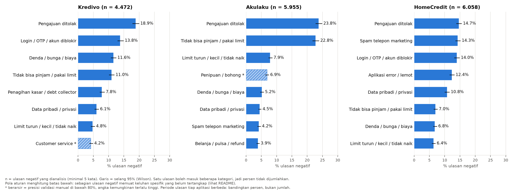
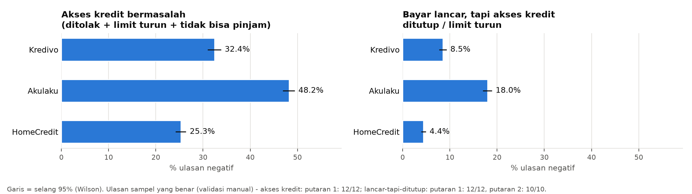

# Suara Pengguna Paylater

Analisis sentimen dan keluhan pada ulasan tiga aplikasi paylater/kredit digital Indonesia di Google Play (Kredivo, Akulaku, Home Credit).

> Status: dalam pengerjaan. Bagian bertanda TODO diisi setelah hasilnya ada.

## Pertanyaan yang dijawab

1. Seberapa besar selisih performa baseline klasik (TF-IDF + Logistic Regression) dengan IndoBERT hasil fine-tuning?
2. Keluhan apa yang paling sering muncul, dan apakah berbeda antar aplikasi?

## Ringkasan temuan

- **IndoBERT lebih baik dari baseline, tetapi selisihnya kecil.** Macro-F1 naik sekitar 0,03 (rata-rata 3 seed). Selisih itu signifikan pada test set berlabel bintang (n = 1.305), tetapi belum bisa dibedakan dari derau pada gold set berlabel manual (n = 596). Akurasi hanya sekitar 0,63-0,67, dan kelas netral paling sulit.
- **Keluhan terbesar adalah akses kredit**: pengajuan ditolak, limit turun, atau tidak bisa pinjam / pakai limit. Di Akulaku hampir separuh ulasan negatif (48,2%) memuat keluhan ini.
- **Banyak yang mengaku sudah bayar lancar, tetapi aksesnya ditutup**: 18,0% ulasan negatif Akulaku, 8,5% Kredivo, 4,4% Home Credit. Kategori ini lolos validasi manual di dua putaran (22 dari 22 ulasan sampel benar).
- **Tiap aplikasi punya keluhan khas.** Spam telepon marketing dan aplikasi error menonjol di Home Credit, dan hampir tidak muncul di dua aplikasi lain.

## Data

- Sumber: ulasan publik Google Play, diambil dengan `google-play-scraper` (`lang="id"`, `country="id"`).
- Aplikasi:

  | Aplikasi       | Package id              |
  | -------------- | ----------------------- |
  | Kredivo        | `com.finaccel.android`  |
  | Akulaku        | `io.silvrr.installment` |
  | My Home Credit | `id.co.myhomecredit`    |

- Tanggal scraping: 17 November 2026
- Jendela waktu (sama untuk kelima bintang): Kredivo sejak 2026-03-01, Akulaku sejak 2026-04-01, Home Credit sejak 2025-01-01. Karena periodenya berbeda, bandingkan **persen** antar aplikasi, bukan jumlah.
- Ulasan mentah: 98.389 (Kredivo 49.351; Akulaku 32.417; Home Credit 16.621); setelah cleaning tetap 98.389 baris, dengan status: 56.115 teks unik, 41.267 salinan teks yang sama (duplikat), 518 salinan berlabel berbeda dari mayoritas (minoritas), 483 teks tanpa sentimen mayoritas yang jelas (ambigu), dan 6 kosong. Hanya teks unik yang dipakai untuk training dan evaluasi model
- Pengambilan data: seluruh ulasan yang memuat teks dalam jendela itu, jadi distribusi bintangnya asli (sangat condong ke bintang 5). Sampel seimbang dibuat di tahap sampling.
- Label untuk training: bintang dipetakan ke sentimen (1-2 negatif, 3 netral, 4-5 positif). Ini label **lemah**: hanya sekitar 62% cocok dengan isi teks.
- Dua set evaluasi: **test (label bintang, n = 1.305)** dan **gold (label manual dari isi teks, 1 pelabel, n = 596)**.
- Privasi: nama dan foto pengguna tidak disimpan; PII di dalam teks sangat jarang (1 email pada pemeriksaan awal) dan tetap di-mask sebelum data dibagikan. Teks ulasan mentah tidak dipublikasikan di repo ini, dan kutipan tidak dipakai di README.

## Struktur folder

```
paylater-review-project/
├── data/
│   ├── raw/         hasil scraping (satu CSV per aplikasi)
│   ├── interim/     setelah cleaning dan normalisasi
│   ├── labeled/     sampel berlabel manual (gold, validasi kategori)
│   └── processed/   train / val / test final
├── notebooks/       eksplorasi dan eksperimen (output dikosongkan)
├── src/             skrip (paths.py, scrape_reviews.py, ...)
├── models/          checkpoint model (tidak di-commit)
├── reports/         ringkasan angka (CSV/teks) dan figures/ (grafik)
└── app/             demo Streamlit / Hugging Face Spaces
```

## Cara menjalankan

Windows (PowerShell), dari folder proyek:

```
python -m venv .venv
.\.venv\Scripts\Activate.ps1
pip install -r requirements.txt

# 1. kumpulkan ulasan (jendela waktu disamakan per aplikasi; total sekitar 45-60 menit)
python src\scrape_reviews.py id.co.myhomecredit --since 2025-01-01
python src\scrape_reviews.py io.silvrr.installment --since 2026-04-01
python src\scrape_reviews.py com.finaccel.android --since 2026-03-01

# 2. bersihkan teks, buang duplikat
python src\preprocess.py

# 3. sampel seimbang + split train/val/test
python src\make_dataset.py

# 4. baseline TF-IDF + Logistic Regression
python src\train_baseline.py

# 5. bandingkan baseline dengan IndoBERT (hasil fine-tuning dari notebook)
python src\bandingkan_model.py

# 6. kategori keluhan (aturan regex), laporan angka, lalu grafik
python src\kategori_keluhan.py
python src\buat_grafik.py
```

Validasi manual kategori: `python src\kategori_keluhan.py --cek 12` membuat sampel untuk dinilai (isi kolom `benar` dengan 1 / 0 / ?), lalu `--hitung-cek <berkas.xlsx>` menghitung presisinya. Folder `data/` dan `models/` tidak ikut repo. Ulasan baru terus muncul di Google Play, jadi scraping ulang di waktu lain akan menghasilkan data yang sedikit berbeda dari yang dipakai di bagian Hasil.

## Hasil

### 1. Baseline vs IndoBERT

IndoBERT dilatih dengan 3 seed (7, 42, 2024). Selang kepercayaan berasal dari bootstrap berpasangan (10.000 resample) pada ulasan yang sama.

**Test set, label bintang (n = 1.305)**

| Model                             | macro-F1          | accuracy          |
| --------------------------------- | ----------------- | ----------------- |
| Baseline TF-IDF + LR              | 0,571             | 0,601             |
| IndoBERT (rata-rata 3 seed)       | 0,602 ± 0,004     | 0,629 ± 0,015     |
| IndoBERT (ensemble 3 seed)        | 0,622             | 0,648             |

Selisih macro-F1 IndoBERT (rata-rata seed) dikurangi baseline: **+0,031**, selang 95% [+0,009, +0,054]. Untuk ensemble: +0,052 [+0,027, +0,076]. Selang keduanya tidak melewati 0.

**Gold set, label manual (n = 596)**

| Model                             | macro-F1          | accuracy          |
| --------------------------------- | ----------------- | ----------------- |
| Baseline TF-IDF + LR              | 0,636             | 0,639             |
| IndoBERT (rata-rata 3 seed)       | 0,661 ± 0,015     | 0,664 ± 0,011     |
| IndoBERT (ensemble 3 seed)        | 0,669             | 0,669             |

Selisih macro-F1 (rata-rata seed): +0,026, selang 95% [-0,010, +0,061]. Ensemble: +0,033 [-0,007, +0,073]. **Selang melewati 0**, jadi pada ukuran sampel ini selisihnya belum bisa dibedakan dari derau.

**Cara membaca angka ini**

- Arah selisihnya konsisten (IndoBERT lebih tinggi di kedua set), tetapi besarnya hanya sekitar 3 poin. Kesimpulan yang aman: IndoBERT cenderung sedikit lebih baik, bukan jauh lebih baik.
- Kelas netral paling sulit untuk kedua model (F1 test 0,35 untuk baseline, 0,39 untuk IndoBERT rata-rata seed). Label bintang untuk kelas netral memang paling berisik.
- Hasil per aplikasi tidak seragam. Di gold set, Home Credit naik cukup besar (+0,074 macro-F1), sedangkan Akulaku justru turun (-0,023). Sampel per aplikasi kecil (150-230), jadi ini petunjuk, bukan bukti.
- Pada gold set, selisih menurut panjang ulasan juga tidak ada yang selangnya lepas dari 0.

### 2. Keluhan per aplikasi

Keluhan dihitung dengan **kategori berbasis aturan (regex)** pada ulasan negatif yang punya minimal 5 kata (Kredivo 4.472, Akulaku 5.955, Home Credit 6.058 ulasan). Satu ulasan boleh masuk beberapa kategori, jadi persen tidak dijumlahkan. Pemodelan topik (BERTopic) dipakai di awal untuk menemukan kategori, tetapi tidak dipakai untuk persentase karena topiknya bercampur dan satu keluhan terpecah ke banyak topik.





Temuan utama (persen dari ulasan negatif tiap aplikasi):

| Keluhan                                   | Kredivo | Akulaku | Home Credit |
| ----------------------------------------- | ------- | ------- | ----------- |
| Akses kredit bermasalah (gabungan)        | 32,4%   | 48,2%   | 25,3%       |
| Bayar lancar, tapi akses ditutup / limit turun | 8,5% | 18,0%   | 4,4%        |
| Pengajuan ditolak                         | 18,9%   | 23,8%   | 14,7%       |
| Tidak bisa pinjam / pakai limit           | 11,0%   | 22,8%   | 7,0%        |
| Spam telepon marketing                    | —       | 4,2%    | 14,3%       |
| Aplikasi error / lemot                    | —       | —       | 12,4%       |

Tanda "—" berarti tidak termasuk 8 keluhan teratas aplikasi itu pada grafik; angka lengkapnya ada di `reports/kategori_keluhan.csv`.

**Validasi manual (presisi).** Dari ulasan yang dicocokkan sebuah kategori, berapa yang memang mengeluhkan hal itu. Penilaian dilakukan satu orang pada sampel acak dalam tiga putaran. Pola disetel pada putaran sebelumnya dan diuji ulang pada sampel yang belum pernah dilihat.

| Kategori                         | Benar / dinilai | Putaran |
| -------------------------------- | --------------- | ------- |
| Bayar lancar tapi akses ditutup  | 10 / 10         | 2 (putaran 1: 12 / 12) |
| Spam telepon marketing           | 10 / 10         | 2       |
| Skor kredit / SLIK               | 10 / 10         | 2       |
| Penagihan                        | 9 / 10          | 2       |
| Dana / pembayaran tidak masuk    | 9 / 10          | 2       |
| Login / OTP / akun diblokir      | 11 / 12         | 3       |
| Belanja / pulsa / refund         | 11 / 12         | 3       |
| Limit turun                      | 8 / 10          | 2       |
| Tidak bisa pinjam / pakai limit  | 8 / 10          | 2       |
| Denda / bunga / biaya            | 8 / 10          | 2       |
| Penipuan / bohong                | 9 / 12          | 3       |
| Customer service                 | 7 / 12          | 3       |

Kategori yang tidak berubah sejak putaran 1 (pengajuan ditolak, CAPTCHA, lucky draw, aplikasi error) dan dua kategori yang polanya sedikit diperluas setelahnya (data pribadi, tagihan padahal tidak pinjam) hanya tervalidasi pada putaran 1. Rinciannya, termasuk selang 95% Wilson, ada di `reports/validasi_kategori*.csv`. Dengan 10-12 ulasan per kategori, selang presisinya lebar (misalnya 8 dari 10 benar berarti sekitar 49-94%), jadi angka di atas adalah gambaran kasar. Kategori dengan presisi di bawah 80% (**penipuan** dan **customer service**) diberi tanda `*` berarsir di grafik dan tidak dipakai untuk klaim utama.

## Keterbatasan

- **Label lemah.** Training dan test utama memakai bintang sebagai label sentimen, yang hanya sekitar 62% cocok dengan isi teks. Gold set mengoreksi sebagian, tetapi dilabeli satu orang tanpa ukuran kesepakatan antar-pelabel.
- **Sampel evaluasi kecil.** Gold set 596 ulasan membuat selisih sekitar 3 poin belum bisa dibedakan dari derau.
- **Kategori keluhan adalah batas bawah.** Pada validasi, sekitar 84% ulasan yang tidak masuk kategori apa pun ternyata masih memuat keluhan spesifik yang terlewat (selang 95% 71-92%). Artinya sekitar seperlima ulasan negatif punya keluhan yang belum tertangkap, dan persentase di atas lebih rendah dari keadaan sebenarnya. Pola aturan juga tidak sempurna: persen yang tercetak sedikit terlalu tinggi untuk kategori dengan presisi di bawah 100%.
- **Cakupan.** Hanya ulasan negatif dengan minimal 5 kata yang dianalisis. Ulasan sangat pendek tidak ikut.
- **Periode berbeda.** Jendela waktu tiap aplikasi tidak sama, dan tren keluhan bisa berubah menurut waktu, jadi perbandingan antar aplikasi bersifat indikatif.
- **Satu platform dan satu penilai.** Hanya ulasan Google Play, dan seluruh validasi manual dilakukan satu orang.
- **Duplikat.** Ulasan identik dihitung sekali pada evaluasi model; pada kategori keluhan salinan ikut dihitung, sehingga selang Wilson sedikit terlalu sempit.

## Demo

TODO: demo Streamlit / Hugging Face Spaces.
